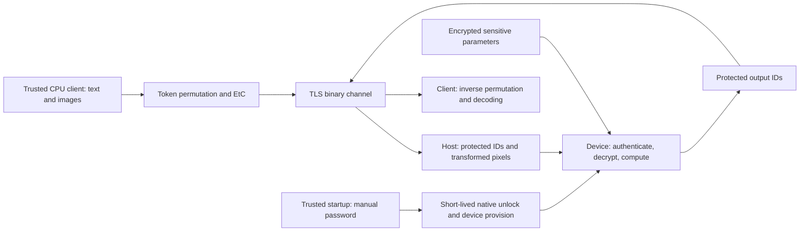

# Architecture, secrets, and trust boundaries

## What each mechanism provides

| Layer | Mechanism | Property |
| --- | --- | --- |
| Data representation | COVERT-style token renumbering and equivalent parameter transformation; EtC block transformations followed by lossless compression | Original token sequences and original pixels do not appear directly in server input buffers, while the model remains computable |
| Parameter sealing | AES-256-GCM for sensitive parameters that can reveal transformation relationships; authentication and decryption on the device | Deployment files and CPU parameter buffers after trusted startup do not directly expose those relationships |
| Transport and access | TLS certificate verification, separately derived password challenge-response, application rate limits | Transport confidentiality, peer authentication, access control, and bandwidth management |

Token permutation and EtC are not general-purpose semantically secure encryption. AEAD parameter sealing is not homomorphic inference. Do not describe executable packing, scrambled names, or renamed parameter tables as confidentiality guarantees. The program itself may be public.

This design uses COVERT's equivalent reparameterization idea without claiming to reproduce every network transformation, tuning step, or security conclusion in the paper. Transform an existing pretrained model offline without training or distillation. Adapt nonequivalent operators or report their limitations.

## Data flow

The CPU may handle public dimensions, profiles, protected token IDs, EtC PNGs, position metadata, encrypted parameters, error codes, and authentication verifiers. It must not receive original token IDs, original vocabulary strings, restored pixels, plaintext mapping-equivalent parameters, long-lived parameter data keys, or unlock keys.

## Selecting the protection boundary

The default implementable boundary is **passive inspection of deployment files and service-process CPU memory after trusted provisioning and trusted startup**. State the following facts explicitly:

- Password entry, KDF execution, data-key unwrapping, and device provisioning briefly expose secrets in controlled CPU buffers. Native handling, memory locking, and erasure shorten their lifetime; they do not defeat surveillance during startup.
- Decrypted parameters, expanded keys, and model intermediates exist on the device. GPU memory, registers, debuggers, drivers, DMA, or active execution tampering require a separately validated trusted-execution boundary.
- A CPU-readable authentication-derived value enables client impersonation. It is not the parameter data key, but with a shared password, captured authentication material or a wrapped key also enables offline password guessing. Six characters is an input-compatibility minimum, not a claim of resistance to offline attacks.
- When authentication and unlocking use the same password, anyone who knows it and obtains the model package can unwrap the key. Do not promise to hide the data key from such authorized users. Use separate passwords/keys if role separation is required, without silently changing the user's chosen semantics.
- Sealing weights does not invalidate an already disclosed token mapping. Rotating the data representation requires reconverting the model and updating every client. Preserve the existing configuration unless rotation is requested.
- Input length, repeated tokens, request timing, image dimensions, public patch order, and output length remain observable. Disk encryption does not remove frequency analysis, known-input attacks, visual reconstruction, or model-behavior attacks.
- Moving old parameters into a trusted provisioning directory on the same machine provides no isolation if the attacker can read that directory too. Backups must be within an explicitly excluded trusted scope or separately encrypted/transferred.

If startup surveillance and device inspection must also be prevented, discover and verify the complete host, device, firmware, driver, interconnect, and attestation capabilities. Use a supported trusted-execution design and validate it again. One supported component does not establish trust for the whole inference pipeline. Do not substitute an unverified register-only key scheme for this boundary.

## Secret lifecycle

| Object | Creation and storage | Online visibility |
| --- | --- | --- |
| Data-transformation seed `S` | Generated during trusted provisioning and stored in the client's private bundle; not directly derived from a short password | Present on the client, absent from the server |
| Forward/inverse token permutations | Reconstructed from `S` on the client; used temporarily during trusted provisioning | No complete independent mapping on the server |
| EtC pixel and PLE feature-coordinate transformations | Domain-separated derivation from `S`, folded into required parameters | Only sealed equivalent parameters on the server |
| Startup password | Entered manually and handled by the native server bootstrap | Briefly present during trusted startup, then erased |
| `K_auth` | Fresh startup salt plus scrypt | Gateway retains the authentication-derived value, separate from model keys |
| `K_wrap` | Package salt, unlock domain, and scrypt | Used only for trusted startup unwrapping, then erased promptly |
| `K_data` | Random 256-bit key generated during trusted provisioning and wrapped with `K_wrap` | Briefly on the CPU during startup; afterward only the expanded key is retained on the device |
| TLS private key | Restricted local server file | Needed by TLS; a separate transport secret, so do not claim the CPU contains no keys at all |
| `profile` / `package` | Public identity markers without the seed | Visible at endpoints and in the deployment package |

`profile` identifies data-transformation compatibility; `package` identifies one parameter-encryption package. Resealing changes `K_data` and `package` while allowing `profile` to remain unchanged. The same model architecture with different seeds does not share a profile.

## Sensitive parameters form a dependency closure

At minimum, inspect input embeddings, output vocabulary projections and biases, every corresponding draft parameter, token-derived hash/routing tables, PLE feature tables, and the first image projection. Trace quantization scales, zero points, adapters, extra output heads, shared/duplicated parameters, and any alternative path that can recover transformations by comparison with original parameters.

Do not select a single table solely by its tensor name. Any readable parameter sufficient to recover a mapping or the original pixel transformation belongs in the sensitive set. Original checkpoints, plaintext transformed checkpoints, verification reports containing sensitive values, and secret compilation constants must not accompany the deployment package. Justify why remaining plaintext parameters are acceptable; do not promise protection of all model-internal information.
